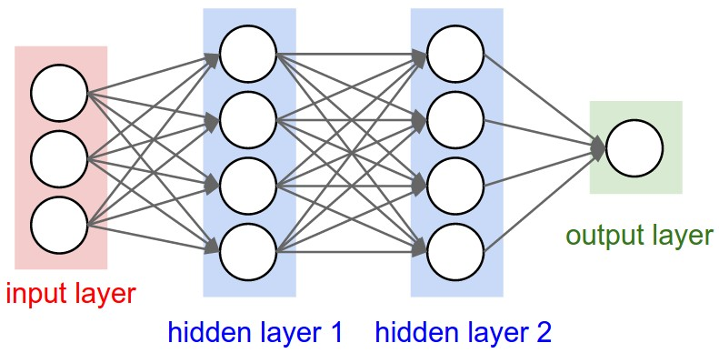
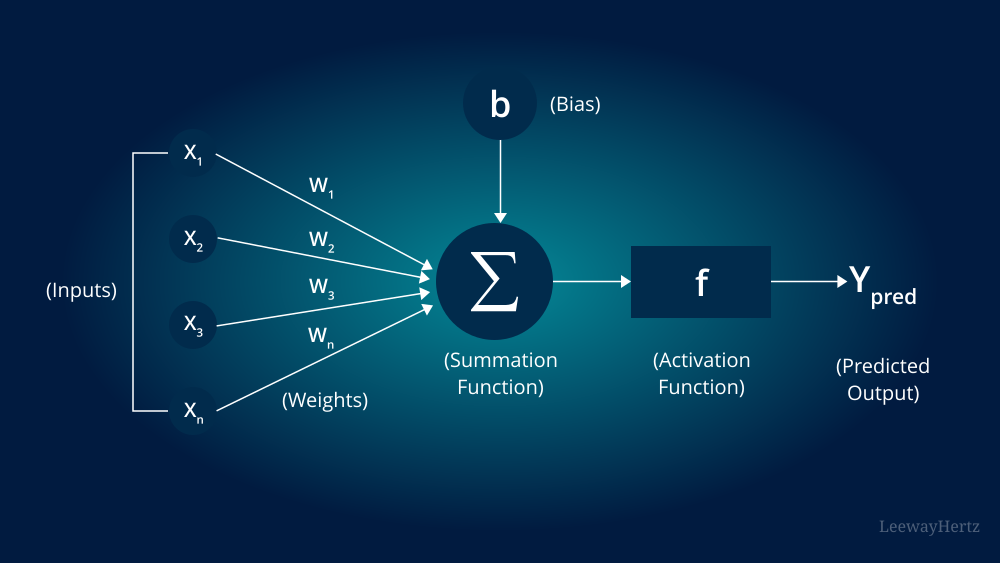

# **Neural Networks**  

## **Introduction to Neural Networks**  
Neural Networks (NNs) are a subset of Machine Learning, inspired by the human brain. They consist of layers of interconnected nodes (neurons) that process and learn patterns from data.  

## **What is a Neural Network?**  
- A **Neural Network** is a computational system that learns patterns and relationships from data.  
- It consists of layers of neurons, each applying mathematical transformations to input data.  
- Used in tasks like image recognition, natural language processing (NLP), and autonomous systems.

## **How Neural Networks Work**  
1. **Input Layer:** Accepts raw data (e.g., pixels from an image, words from a sentence).  
2. **Hidden Layers:** Extracts features and patterns using weighted connections and activation functions.  
3. **Output Layer:** Produces the final prediction (e.g., classification label, probability score).  
4. **Learning Process:** Adjusts weights using optimization techniques like Gradient Descent.  

## **Types of Neural Networks**  
| Type | Description | Common Applications |  
|------|------------|---------------------|  
| **Feedforward Neural Network (FNN)** | Basic neural network where information flows in one direction | Classification, Regression |  
| **Convolutional Neural Network (CNN)** | Specialized in image processing | Object detection, Face recognition |  
| **Recurrent Neural Network (RNN)** | Designed for sequential data | Speech recognition, Time series forecasting |  
| **Long Short-Term Memory (LSTM)** | Advanced version of RNN with memory gates | Text generation, Language modeling |  
| **Transformers** | State-of-the-art models for NLP | Machine translation, Chatbots |  
| **Generative Adversarial Networks (GANs)** | Used for generating new data | Deepfake images, Art generation |  

## **Components of a Neural Network**  
### 1. **Neurons**  
- The basic unit of a neural network, mimicking a biological neuron.  
- Processes input, applies an activation function, and passes output forward.  

### 2. **Weights & Biases**  
- Weights determine the importance of inputs.  
- Biases allow flexibility in the learning process.  

### 3. **Activation Functions**  
- Introduce non-linearity to the model.  
- Common activation functions:  
  - **ReLU (Rectified Linear Unit)** – Used in deep networks.  
  - **Sigmoid** – Used for binary classification.  
  - **Tanh** – Scales values between -1 and 1.  
  - **Softmax** – Converts logits to probabilities in multi-class classification.  

---