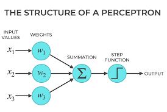
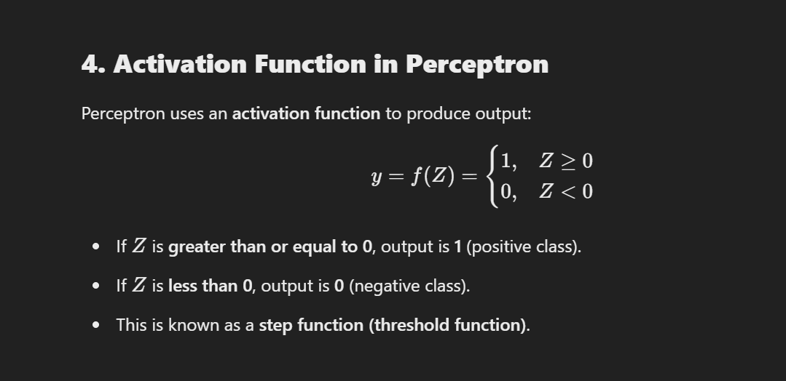

# **Perceptron (Single-Layer Neural Network)**  

## **Introduction to Perceptron**  
- A **Perceptron** is the simplest type of artificial neural network.  
- It consists of a **single layer** of neurons that perform **binary classification** tasks. 

## **Structure of a Perceptron**  
A perceptron consists of:  
1. **Inputs (\(x_1, x_2, ..., x_n\))** – Feature values of input data.  
2. **Weights (\(w_1, w_2, ..., w_n\))** – Each input has an associated weight that determines its importance.  
3. **Summation Function (\(Z\))** – Computes the weighted sum of inputs:  
   \[
   Z = (w_1 x_1 + w_2 x_2 + ... + w_n x_n) + b
   \]  
4. **Bias (\(b\))** – Shifts the decision boundary.  
5. **Activation Function** – Applies a transformation to decide the output.  

---

## **Working of a Perceptron**  
### **Step-by-step process:**  
1. **Initialize Weights & Bias**:  
   - Start with small random values.  
2. **Compute Weighted Sum**:  
   - Multiply inputs with corresponding weights and add bias.  
3. **Apply Activation Function**:  
   - Use an activation function to determine the final output.  
        
4. **Compare Output & Target**:  
   - Calculate the error between the predicted and actual output.  
5. **Update Weights** (Learning Rule):  
   - Adjust weights based on error using the learning rule.  

## **Learning Algorithm (Perceptron Learning Rule)**  
The perceptron learns using the following algorithm:  

1. **Initialize weights and bias randomly.**  
2. **For each input instance** (\( x \)), do:  
   - Compute weighted sum: `( Z = w_1x_1 + w_2x_2 + ... + w_nx_n + b )`  
   - Apply activation function: `( y = f(Z) ) `
   - Update weights if prediction is incorrect: 
    `w_new = w_old + η(y−y^)x`
   - Repeat until convergence.  

## **Example of Perceptron Working (AND Gate)**  

### **Truth Table for AND Gate**  
| \(x_1\) | \(x_2\) | \( y \) (Expected Output) |  
|------|------|  
| 0 | 0 | 0 |  
| 0 | 1 | 0 |  
| 1 | 0 | 0 |  
| 1 | 1 | 1 |  

### **Assumptions**  
- Let initial weights:  w_1 = 0.5, w_2 = 0.5 
- Bias  b = -0.7
- Learning rate η = 0.1
- Activation function: **Step Function**  

**Step-by-step process for input (1,1):**  

Step-by-step process for input (1,1):  
    
    Z=(w1⋅x1 + w2⋅x2 + b)

    Z=(0.5×1+0.5×1−0.7)=0.3

    f(Z)=1,since 0.3 ≥ 0
    

The output \( y \) is **1**, which matches the AND gate's expected output. If the output were incorrect, the weights would be updated using the Perceptron Learning Rule.  

---