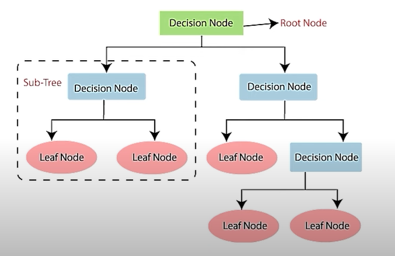

# **Decision Tree**  

- A **Decision Tree** is a **Supervised Learning** technique used for both **Classification** and **Regression** problems, though it is mostly preferred for **Classification** tasks.  
- The tree is constructed using the **CART algorithm (Classification and Regression Tree algorithm)(Binary Splitting).**  

> **Key Concept:**  
> **Decision Trees work with non-linear splitting of data.**  

  

---

## **Pruning**  
When a **Decision Tree** becomes too large, it may lead to **overfitting.**  
To prevent this, we use **Pruning**, which removes unnecessary branches or sub-nodes.  

- **Pruning:** The process of **removing sub-nodes** from a decision node to simplify the tree and reduce overfitting.  
  - It is the **opposite of splitting.**  

---

## **Attribute Selection Measures (ASM)**  
ASM helps in selecting the best attribute for the nodes of a decision tree.  
The two most common methods are:  

1. **Information Gain**  
2. **Entropy / Gini Index**  

---

## **Entropy**  
- **Entropy** measures the **impurity** or **randomness** in a dataset.  
- Lower entropy means **higher purity**, which is preferred for **early splitting** as it provides **better information gain.**  

`
Entropy(S) = - P(yes)*log_2 P(yes) - P(no)*log_2 P(no)
`

Where:  
- **S** = Total number of samples  
- **P(yes)** = Probability of "yes" outcomes  
- **P(no)** = Probability of "no" outcomes  

---

## **Information Gain**  
- **Information Gain (IG)** measures the **reduction in entropy** after splitting the dataset based on an attribute.  
- It calculates **how much information** a feature provides about the target class.  

`Information Gain = Entropy(S)- [ (Weighted Avg) E tropy(each feature)]`

> **Selection Criteria:**  
> We prefer attributes with **low impurity** and **high information gain** for decision node selection.

---

## **Gini Index**  
- The **Gini Index** is another measure of impurity used in the **CART (Classification and Regression Tree) algorithm.**  
- **A lower Gini Index is preferred** because it indicates higher purity.  

`Gain = Entropy(S)- [ (Weighted Avg) Entropy(each feature)]`

---

### **Conclusion**  
- Decision Trees are powerful for classification problems but require techniques like **pruning** to prevent overfitting.  
- The **best split** is determined using **Entropy, Information Gain, or Gini Index**, prioritizing **low impurity and high information gain.**

---