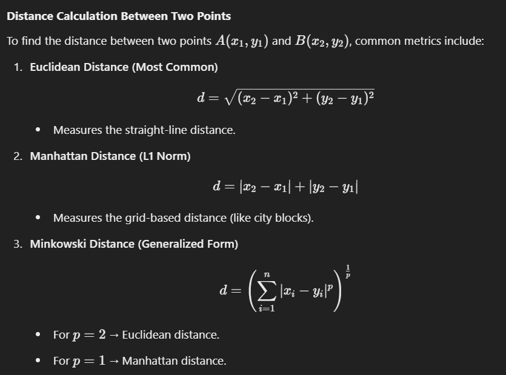
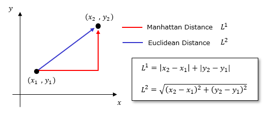

# K-Nearest Neghibours

- K-NN algorithm can be used for Regression as well as for Classification
but mostly it is used for the Classification problems.
- K-NN is a non-parametric algorithm, which means it does not make any
assumption on underlying data.
- It is also called a lazy learner algorithm.

## **How KNN Works**  
1. **Training Phase:**  
   - KNN is a **lazy learning algorithm**, meaning it does not learn a model during training. It simply stores all the training data.  

2. **Prediction Phase:**  
   - When given a new data point, KNN finds the **K closest points** from the training dataset.  
   - It calculates the distance between the new point and all training points.  
   - The class (for classification) or average value (for regression) of the **K nearest neighbors** determines the final prediction.  

3. **Choosing K:**  
   - **Small K:** More sensitive to noise, leading to overfitting.  
   - **Large K:** Smoother decision boundary, reducing sensitivity to noise but can underfit.  

## **Distance Calculation Between Two Points**  

---