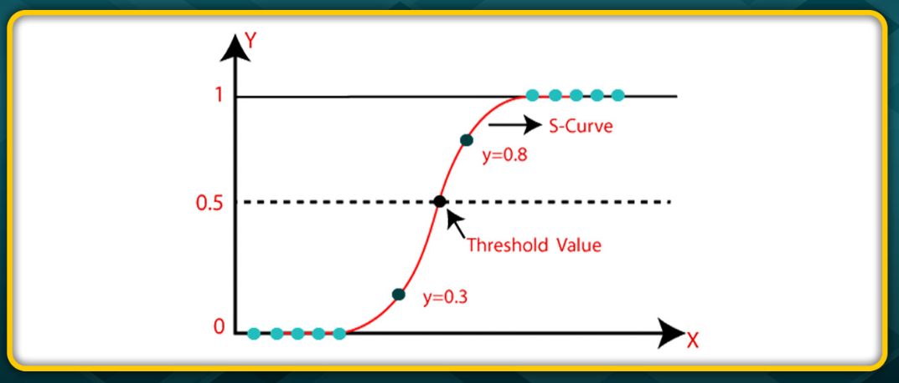

# Logistic Regression

**For Logistic Regression to be applied the data must be Linearly Seperable**

- Logistic regression is one of the most popular Machine Learning algorithms, which comes under the Supervised Learning technique.
- It is used for predicting the categorical dependent variable using a given set of independent variables.
- Therefore, the outcome must be a categorical or discrete value. It can be either Yes or No, O or 1, true or  alse, etc. but instead of giving the exact value as O and 1, it gives the probabilistic values which lie between O and 1.

## Types of Logistic Regression

On the basis of the categories, Logistic Regression can be classified into three types:
- **Binomial:** In binomial Logistic regression, there can be only two possible types of the
dependent variables, such as O or I, Pass or Fail, etc.
- **Multinomial:** In multinomial Logistic regression, there can be 3 or more possible unordere
types of the dependent variable, such as "cat", "dogs", or "sheep".
- **Ordinal:** In ordinal Logistic regression, there can be 3 or more possible ordered types of
dependent variables, such as "Iow , Medium", or "High"

### Sigmoid Function

Logistic Regression works on Sigmoid Function

    y = 1 / (1 + e^-x)
where:
- y = independent
- x = dependent
- e (Euler's Constant) = -2.71828

