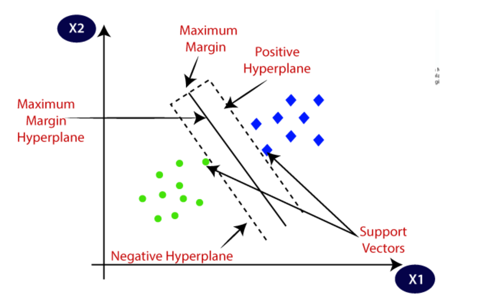

# **Support Vector Machine (SVM) Notes**

## Overview
- SVM is a popular Supervised Learning algorithm used for **Classification** and **Regression** problems.
- It works by finding the optimal hyperplane that best separates different classes in the data.

## Hard Margin vs. Soft Margin
- **Hard Margin**:
  - Used when the data is perfectly separable.
  - No misclassifications allowed.
  - May not generalize well if data has noise.
- **Soft Margin**:
  - Allows some misclassifications.
  - Helps generalize better to unseen data.
  - More robust to outliers.

## Types of SVM
1. **Linear SVM**: Used when the data is linearly separable.
2. **Non-linear SVM**: Used when the data is not linearly separable, requiring kernel functions.

## Simple SVM vs. Kernel SVM
- **Simple SVM**: Works well with linear regression and classification problems.
- **Kernel SVM**: Extends SVM to handle non-linearly separable data by transforming input features into higher-dimensional spaces.

## Kernel Functions
1. **Linear Kernel**: Used for linearly separable data.
2. **Polynomial Kernel**: Captures non-linearity by adding polynomial features.
3. **Gaussian RBF Kernel**: Projects data into an infinite-dimensional space for better classification.
4. **Sigmoid Kernel**: Mimics the behavior of neural networks.

## How SVM Works
- **For Linear Data**:
  - Identifies a hyperplane that separates the classes with the maximum margin.
  - The support vectors (points closest to the hyperplane) determine the margin.
- **For Non-Linear Data**:
  - Uses kernel tricks to map the data into a higher-dimensional space where it can be linearly separated.
  - Finds the best hyperplane in this transformed space.

## Key Advantages of SVM
- Effective in high-dimensional spaces.
- Works well with small datasets.
- Robust against overfitting (especially with soft margin and regularization).

## Applications of SVM
- Image classification
- Text categorization
- Handwriting recognition
- Bioinformatics (e.g., gene classification)

---

