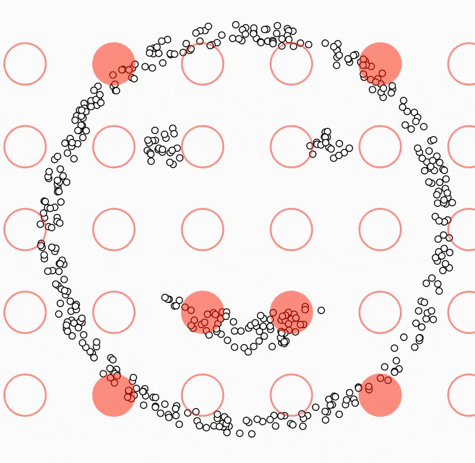

# **DBSCAN Clustering Algorithm**  

## **Overview**  
DBSCAN (**Density-Based Spatial Clustering of Applications with Noise**) is a clustering algorithm that groups **densely packed points** together while marking points in sparse regions as **outliers (noise).** Unlike K-Means and Hierarchical clustering, **DBSCAN does not require the number of clusters (K) to be pre-defined** and can detect arbitrarily shaped clusters.  

### **Advantages of DBSCAN:**  
✅ Works well with **non-linearly separable** data.  
✅ Automatically determines the number of clusters.  
✅ Robust to **outliers and noise**.  
✅ Detects clusters of **arbitrary shape**.  

### **Disadvantages of DBSCAN:**  
❌ Does not work well if the dataset has **varying densities**.  
❌ Not suitable for **high-dimensional** data due to distance calculations.  

---

## **Key Concepts in DBSCAN**  

### **1. Epsilon (ε - Neighborhood Radius)**  
- Defines the **radius** around a data point to consider as a neighborhood.  
- If a point has **enough neighbors** within this radius, it becomes a **core point**.  

### **2. Minimum Points (MinPts)**  
- The **minimum number of points** required within the **ε radius** for a point to be considered a **core point**.  
- Determines **cluster density**:  
  - **Higher MinPts → fewer clusters** (denser clusters).  
  - **Lower MinPts → more clusters** (sparser clusters).  

### **3. Core Point**  
- A data point that has at least **MinPts** neighbors within its **ε radius**.  
- **Always part of a cluster**.  

### **4. Border Point**  
- A point within **ε radius** of a **core point**, but it has **fewer than MinPts neighbors**.  
- **Belongs to a cluster but is not a core point**.  

### **5. Noise Point (Outlier)**  
- A point that is **not a core point** and does **not belong to any cluster**.  
- DBSCAN marks these points as **outliers**.  

---

## **How DBSCAN Works?**  

1️⃣ **Pick a random point** and check its **ε-neighborhood**.  
2️⃣ If it has at least **MinPts neighbors**, it becomes a **core point** and a **new cluster** starts.  
3️⃣ If not, it is labeled as **noise** (but can later be reclassified as a border point).  
4️⃣ **Expand the cluster** by adding all directly reachable **core and border points**.  
5️⃣ Repeat the process until **all points are visited**.  

---

## **Choosing the Best Epsilon (ε) Value**  
- **Use a k-distance graph**:  
  1. Sort distances of every point to its **k-th nearest neighbor**.  
  2. Plot these distances.  
  3. The point where the curve has a **sharp drop ("elbow point")** is the best **ε value**.  

---

## **Comparison of DBSCAN with Other Clustering Methods**  

| **Method**  | **Shape of Clusters** | **Handles Outliers?** | **Requires K?** | **Scalability** |  
|------------|----------------------|----------------------|-----------------|---------------|  
| K-Means    | Circular / Spherical  | ❌ No                | ✅ Yes           | ⚡ Fast       |  
| Hierarchical | Tree-based Structure | ❌ No                | ✅ Yes           | 🐢 Slow       |  
| **DBSCAN** | Arbitrary Shapes      | ✅ Yes               | ❌ No            | 🐢 Slow       |  

---

## **Conclusion**  
- **Use DBSCAN** when dealing with **non-linear, arbitrarily shaped clusters** and **datasets with noise or outliers**.  
- **Avoid DBSCAN** when working with **high-dimensional data** or datasets with **varying densities**.  

---