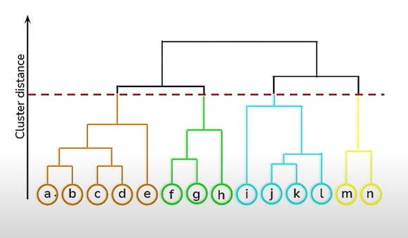
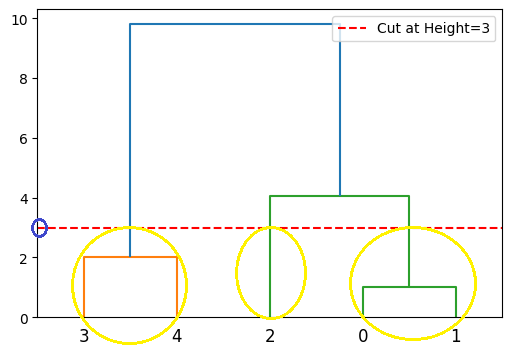

# **Hierarchical Clustering**  

## **Overview**  
- Hierarchical Clustering is an **unsupervised learning** technique used for **grouping unlabeled data** into clusters.  
- It builds a hierarchy of clusters in a **tree-like structure**, called a **dendrogram**.  
- It does **not require specifying the number of clusters (k) beforehand**, unlike K-Means.  

---

## **Types of Hierarchical Clustering**  

### **1. Agglomerative Clustering (Bottom-Up Approach)**  
✅ **How it works?**  
- Each data point is initially treated as an **individual cluster**.  
- It **merges** the closest clusters **iteratively** until only one cluster remains.  
- Uses **linkage methods** to determine cluster merging.  

---

### **2. Divisive Clustering (Top-Down Approach)**  
✅ **How it works?**  
- Starts with **one large cluster** containing all data points.  
- **Splits** clusters iteratively until each data point is a separate cluster.  
- **Less common** than Agglomerative Clustering.  

---

## **Dendrogram in Hierarchical Clustering**  
📌 **What is a dendrogram?**  
- A **tree-like structure** that represents how clusters are merged or split at different distances.  
- **X-axis**: Represents data points.  
- **Y-axis**: Represents the **Euclidean distance** between clusters.  

📌 **How to use the dendrogram?**  
- The **optimal number of clusters** can be selected by cutting the dendrogram at the **longest vertical distance** without crossing a horizontal line.  

  

---

## **Distance Measurement in Hierarchical Clustering**  
The way **distance is measured** between clusters affects the final clustering structure.  

### **Linkage Methods (Cluster Distance Calculation)**  

1. **Single Linkage (Min Distance)**  
   - Distance between the **closest** points of two clusters.  
   - May create **long chains** of clusters.  

2. **Complete Linkage (Max Distance)**  
   - Distance between the **farthest** points of two clusters.  
   - Results in **compact and evenly sized clusters**.  

3. **Average Linkage (Avg Distance)**  
   - Distance between the **centroid (average) of points** in two clusters.  
   - Balances **compactness and separation**.  

4. **Centroid Linkage (Centroid Distance)**  
   - Distance between the **centroids** of two clusters.  
   - More **sensitive to outliers**.  

---

## **How to Select the Best Number of Clusters?**  
✅ **Using the Dendrogram**  
- Cut the dendrogram at the **longest vertical line** without crossing a horizontal linkage.  
- The number of resulting clusters is the **optimal number of clusters**.  

✅ **Using the Elbow Method (for hierarchical clustering)**  
- Plot the **intra-cluster variance** against the number of clusters.  
- The "elbow" point where variance **decreases slowly** is the optimal number of clusters.  

✅ **Silhouette Score**  
- Measures how similar a data point is to its own cluster vs. other clusters.  
- **Higher silhouette score** indicates **better clustering**.  

---

## **Conclusion**  
- Hierarchical Clustering is ideal for **small datasets** where cluster relationships need to be **visualized**.  
- It is computationally **expensive for large datasets**, where **K-Means** may be a better choice.  
- The **choice of linkage method** affects the cluster formation significantly.  
- **Dendrogram analysis** helps in deciding the **optimal number of clusters**.  
---