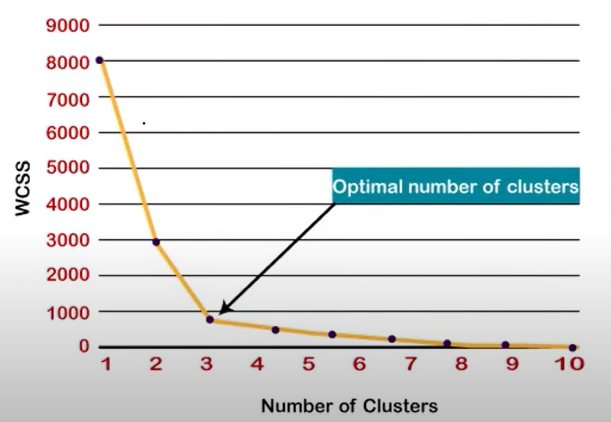

# **K-Means Clustering**  

## **Overview**  
- **K-Means** is an **Unsupervised Learning** algorithm used for **clustering** unlabeled data.  
- The algorithm **groups similar data points** into **K distinct clusters** based on their features.  
- K represents the **predefined number of clusters** that the data will be divided into.  

`Notes: Requires Lineraly Seperable Data`

---

## **How K-Means Works?**  

### **Step 1: Choose the number of clusters (K)**  
- The user must **predefine K**, which represents the number of clusters.  

### **Step 2: Initialize Centroids**  
- Select **K random points** from the dataset as the **initial centroids**.  
- (In **K-Means++**, centroids are chosen carefully to improve accuracy).  

### **Step 3: Assign Data Points to the Nearest Centroid**  
- Each data point is assigned to the **closest centroid** based on **Euclidean distance**.  
- This forms **K groups (clusters)**.  

### **Step 4: Compute New Centroids**  
- For each cluster, compute the **new centroid** as the **mean of all points** in that cluster.  

### **Step 5: Repeat Until Convergence**  
- Steps 3 and 4 are **repeated iteratively** until the centroids **no longer change** significantly.  
- The final clusters are formed when **data points remain stable**.  

---

## **Elbow Method: Finding the Optimal K**  

- Choosing the right number of clusters (**K**) is crucial.  
- **Elbow Method** helps determine the optimal value of **K** using **WCSS (Within-Cluster Sum of Squares)**.  

### **How the Elbow Method Works?**  
1. Compute **WCSS** for different values of **K**.  
2. Plot **K vs. WCSS** on a graph.  
3. The **optimal K** is at the "elbow" (where the decrease in WCSS slows down).  

**Example Graph:**  
  

---

## **K-Means++: Improved Initialization**  
- **Problem with Standard K-Means:** Sometimes, centroids start **too close**, leading to **poor clustering**.  
- **Solution:** **K-Means++** improves **centroid initialization** by ensuring they are **spread out**.  

### **Steps in K-Means++**  
1. Choose **first centroid randomly** from data points.  
2. For each remaining centroid, choose a **point farthest** from existing centroids.  
3. Repeat until **K centroids are initialized**.  
4. Continue with the standard **K-Means algorithm**.  

✔ **Advantage:** Leads to **better convergence** and **more stable clusters** compared to standard K-Means.  

---

## **Applications of K-Means Clustering**  
- **Customer Segmentation** (e.g., grouping customers based on shopping behavior).  
- **Image Segmentation** (e.g., separating objects in an image).  
- **Anomaly Detection** (e.g., detecting fraud in financial transactions).  
- **Document Clustering** (e.g., grouping similar articles or news topics).  

---

## **Conclusion**  
- **K-Means** is a powerful **clustering algorithm** but requires a **predefined K**.  
- **Elbow Method** helps in choosing the **optimal number of clusters**.  
- **K-Means++** improves clustering **stability** by initializing centroids efficiently.  
- **Widely used in real-world applications** for grouping similar data. 🚀