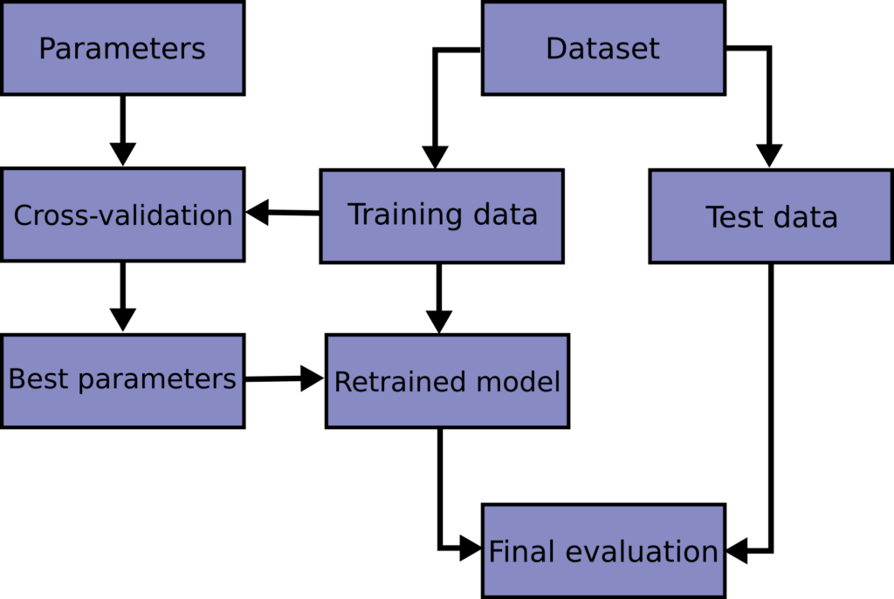

# **Cross-Validation in Machine Learning**  

## **Overview**  
- **Cross-validation** is a technique for evaluating a model’s performance by training it on a subset of the dataset and testing it on unseen data.  
- Helps in **reducing overfitting** and ensures that the model **generalizes well** to new data.  

---

## **Types of Cross-Validation**  

### **1. Holdout Cross-Validation**  
✅ **How it works?**  
- Splits the dataset into **training** and **testing** sets (e.g., 80% training, 20% testing).  
- The model is trained on the training set and evaluated on the test set.  

❌ **Disadvantage**:  
- Performance may depend on how the data is split.  
- If the dataset is small, the test set may not represent the full distribution.  

---

### **2. K-Fold Cross-Validation**  
✅ **How it works?**  
- The dataset is divided into **k** equal parts (folds).  
- The model is trained on **(k-1) folds** and tested on the remaining fold.  
- This process is repeated **k times**, and the final result is the **average performance** across all folds.  

❌ **Disadvantage**:  
- Not ideal for **imbalanced datasets** (some classes might not appear in each fold).  

---

### **3. Stratified K-Fold Cross-Validation**  
✅ **How it works?**  
- Similar to **K-Fold**, but ensures that **each fold maintains the same class distribution** as the original dataset.  
- Used when the dataset is **imbalanced** (i.e., some classes appear much more than others).  

✔ **Advantage**:  
- More reliable results for **classification problems with imbalanced data**.  

---

### **4. Leave-One-Out Cross-Validation (LOOCV)**  
✅ **How it works?**  
- A special case of K-Fold where **k = total number of samples**.  
- Each instance in the dataset is used as a test set **exactly once**, and the model is trained on the rest.  

✔ **Advantage**:  
- Uses maximum training data, leading to **low bias**.  

❌ **Disadvantage**:  
- **Computationally expensive** for large datasets.  

---

### **5. Leave-P-Out Cross-Validation (LpOCV)**  
✅ **How it works?**  
- A generalization of LOOCV, where **p** samples are left out as the test set, and the model is trained on the rest.  
- The process is repeated for all possible **p-sized subsets**.  

✔ **Advantage**:  
- More flexible than LOOCV.  

❌ **Disadvantage**:  
- **Computationally infeasible** for large datasets.  

---

### **6. Time Series Cross-Validation**  
✅ **How it works?**  
- Used for **time-dependent** data (e.g., stock prices, weather forecasts).  
- Instead of randomly splitting data, it **respects the time order** (training on past data, testing on future data).  

✔ **Advantage**:  
- Ensures that the model does not **learn from future data** (avoids data leakage).  

❌ **Disadvantage**:  
- Training data is always **smaller in earlier folds**, affecting performance.  

---

### **7. Nested Cross-Validation**  
✅ **How it works?**  
- A combination of **k-fold cross-validation** and **hyperparameter tuning**.  
- The dataset is split into **inner and outer loops**:  
  - The **outer loop** is used for model evaluation.  
  - The **inner loop** is used for **hyperparameter tuning**.  

✔ **Advantage**:  
- **Prevents overfitting** when selecting the best model.  

❌ **Disadvantage**:  
- **Computationally expensive** since it runs multiple cross-validation loops.  

---

## **Comparison of Cross-Validation Techniques**  

| Technique | Suitable For | Pros | Cons |
|-----------|------------|------|------|
| Holdout CV | Large datasets | Simple, fast | May not represent full data distribution |
| K-Fold CV | General ML problems | More reliable, uses more data for training | Slow for large datasets |
| Stratified K-Fold CV | Imbalanced datasets | Maintains class distribution | More complex |
| LOOCV | Small datasets | Uses max training data | Computationally expensive |
| Leave-P-Out CV | Small datasets | More flexible than LOOCV | Very slow for large datasets |
| Time Series CV | Time-dependent data | Avoids data leakage | Limited training data in early folds |
| Nested CV | Hyperparameter tuning | Reduces overfitting | Computationally expensive |

---

## **Conclusion**  
- **K-Fold Cross-Validation** is the most commonly used method for general problems.  
- **Stratified K-Fold** is ideal for **imbalanced classification**.  
- **Time Series Cross-Validation** is a must for **time-dependent** datasets.  
- **Nested Cross-Validation** is great for **model selection and tuning**.  
