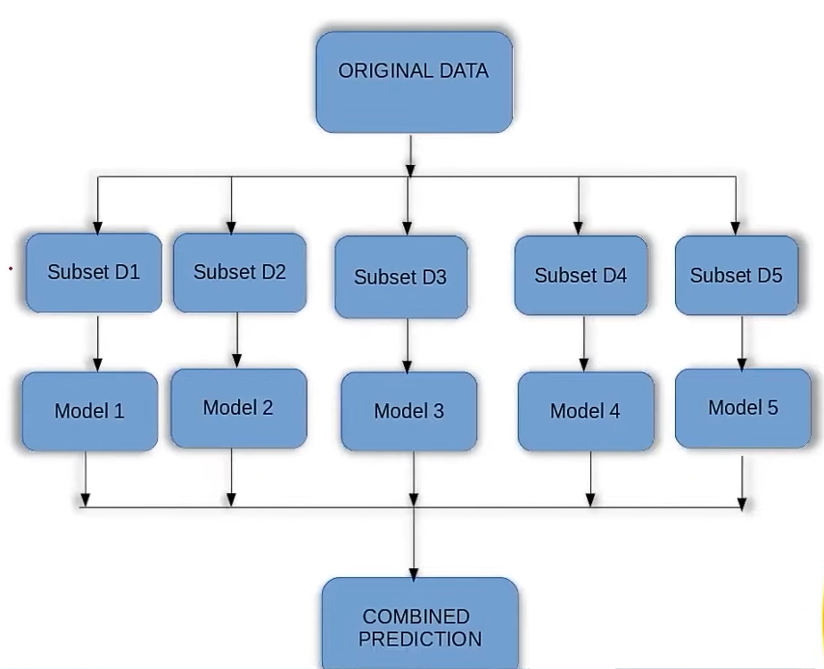

# **Bagging (Bootstrap Aggregating)**  

Bagging is an **ensemble learning technique** that improves model stability and accuracy by reducing **variance** and preventing **overfitting**. It involves training multiple models on **random subsets (bags)** of the original dataset and aggregating their predictions.  

---

## **How Bagging Works?**  
1. Multiple **random subsets** (with replacement) are created from the original dataset.  
2. A **base model** (e.g., decision tree) is trained on each subset independently.  
3. Final prediction is made by **aggregating results** from all models.  
   - **Classification** → Majority voting.  
   - **Regression** → Average of predictions.  

📌 **Why Use Bagging?**  
✔ Reduces **variance** (prevents overfitting).  
✔ Works well with **high variance models (e.g., decision trees)**.  
✔ Improves **stability** and **generalization**.  

---

## **Bagging Algorithms**  

### **1️⃣ Bagging Meta-Estimator**  
✔ A generic **bagging-based ensemble** model that can be used for both:  
   - **Classification** → `BaggingClassifier`  
   - **Regression** → `BaggingRegressor`  
✔ The **default base model** is **Decision Tree**, but it can be replaced with any ML model.  

📌 **Best When?**  
✔ The base model is **unstable/high variance** (like Decision Trees).  
✔ The dataset has **complex patterns**.  

---

### **2️⃣ Random Forest**  
✔ **Extension of Bagging** that uses multiple **Decision Trees**.  
✔ Introduces **random feature selection** for each tree → More **diversity** in models.  
✔ Uses **majority voting (classification)** or **averaging (regression)** for predictions.  

📌 **Why Random Forest?**  
✔ Reduces **both variance and bias**.  
✔ Handles **large datasets** with **many features**.  
✔ Works well even when **some features are irrelevant/noisy**.  

---

## **Comparison: Bagging Meta-Estimator vs. Random Forest**  

| Feature | Bagging Meta-Estimator | Random Forest |
|---------|-----------------------|---------------|
| **Base Model** | Any ML model (default: Decision Tree) | Decision Trees only |
| **Feature Selection** | Uses all features | Randomly selects subset of features |
| **Diversity in Models** | From different datasets (bootstrapping) | From both datasets and feature selection |
| **Bias-Variance Tradeoff** | Reduces variance | Reduces variance **and** bias |
| **Best For** | Any ML model (unstable ones preferred) | Decision Trees |

---

## **Conclusion**  
🚀 **Bagging is an excellent technique to reduce overfitting and improve accuracy!**  
✔ **Bagging Meta-Estimator** → Works with any base model.  
✔ **Random Forest** → Best for decision trees and high-dimensional datasets.  

💡 **Use Bagging when variance is high, and Random Forest when both variance and bias need to be controlled.**

---