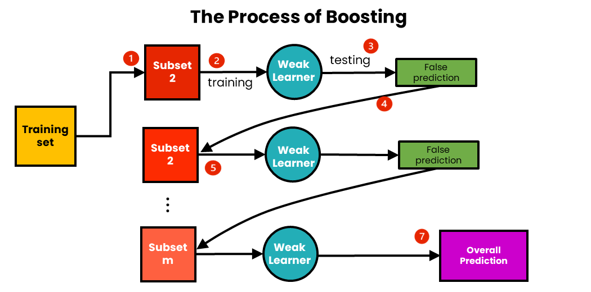

# **Boosting**  

Boosting is an **ensemble learning technique** that improves model accuracy by sequentially training weak models and correcting their errors. Unlike bagging, boosting focuses on **reducing bias** and improving **predictive power** by giving more importance to misclassified instances.  

---

## **How Boosting Works?**  
1. A **weak learner** (e.g., decision stump) is trained on the dataset.  
2. The model’s **errors are identified**, and more weight is given to misclassified instances.  
3. A new weak learner is trained, correcting the previous model’s errors.  
4. This process is repeated, and the final model is an **ensemble of all weak learners**.  
   - **Classification** → Weighted majority voting.  
   - **Regression** → Weighted sum of predictions.  

📌 **Why Use Boosting?**  
✔ Reduces **bias** (handles underfitting).  
✔ Works well with **weak learners**.  
✔ Improves **predictive performance** significantly.  

---

## **Boosting Algorithms**  

### **1️⃣ AdaBoost (Adaptive Boosting)**  
✔ Combines multiple **weak learners** (default: Decision Stumps).  
✔ Assigns **higher weights** to misclassified samples.  
✔ Final prediction is a **weighted sum** of all learners’ outputs.  

📌 **Best When?**  
✔ The base model is **weak/simple** (e.g., Decision Stumps).  
✔ The dataset has **noise and outliers**.  

---

### **2️⃣ Gradient Boosting**  
✔ Builds new models to **correct errors** of previous models.  
✔ Uses **gradient descent optimization** to minimize errors.  
✔ Can be used with **any differentiable loss function**.  

📌 **Why Gradient Boosting?**  
✔ Handles **complex relationships** in data.  
✔ Provides **flexibility** in choosing loss functions.  
✔ Works well with **structured datasets**.  

---

### **3️⃣ XGBoost (Extreme Gradient Boosting)**  
✔ An optimized version of Gradient Boosting with **regularization**.  
✔ Faster due to **parallelized computation**.  
✔ Handles **missing values** and **sparse data** efficiently.  

📌 **Why XGBoost?**  
✔ Reduces **overfitting** with L1/L2 regularization.  
✔ Highly **scalable** and **efficient**.  
✔ Used in **many Kaggle competitions** due to its performance.  

---

### **4️⃣ LightGBM (Light Gradient Boosting Machine)**  
✔ A **faster and more memory-efficient** alternative to XGBoost.  
✔ Uses **leaf-wise growth** instead of level-wise growth.  
✔ Handles **large datasets** with ease.  

📌 **Why LightGBM?**  
✔ **Extremely fast** training time.  
✔ Works well with **high-dimensional data**.  
✔ **Supports categorical features natively**.  

---

## **Comparison: AdaBoost vs. Gradient Boosting vs. XGBoost vs. LightGBM**  

| Feature | AdaBoost | Gradient Boosting | XGBoost | LightGBM |
|---------|---------|-----------------|--------|---------|
| **Base Model** | Weak learners (e.g., stumps) | Any ML model | Any ML model | Any ML model |
| **Optimization** | Weighted errors | Gradient descent | Optimized gradient descent | Leaf-wise growth |
| **Speed** | Slow | Moderate | Fast | Very Fast |
| **Regularization** | No | No | L1/L2 | L1/L2 |
| **Best For** | Simple models, reducing bias | Complex data patterns | Large-scale datasets | Large and high-dimensional datasets |

---

## **Conclusion**  
🚀 **Boosting is a powerful technique to improve model accuracy and reduce bias!**  
✔ **AdaBoost** → Works well for simple models.  
✔ **Gradient Boosting** → Ideal for structured datasets.  
✔ **XGBoost** → Optimized and widely used for performance.  
✔ **LightGBM** → Best for large datasets with high-dimensional features.  

💡 **Use Boosting when bias is high, and you need strong predictive performance!**  

---

